# Graph-Aware Initialization for Image Dehazing

**Technical report — computation-graph analysis, variance propagation, DPI and GAI initialization**

*CPU small-scale initial probing and 12-epoch short-training convergence study · 2026-11-22*

## Abstract

Parameter initialization determines signal propagation, gradient flow and the final
convergence destination of a deep dehazing model. This study surveys nine
representative dehazing methods, from early convolutional networks to Transformers,
and inspects the initialization code in their public implementations. Starting from the
atmospheric scattering model and forward/backward variance-propagation theory, we
derive the task-specific constraints that initialization must satisfy.

We then treat a dehazing network as a directed computation graph: operations recorded
by automatic differentiation are nodes, tensor data-flow links are edges. We
automatically extract topological descriptors — critical-path depth, dense-branch
fan-in, residual/skip links, attention gates and dense concatenation — and propose
two dehazing-specific initializations. **DPI** (Dehazing-aware Parameter
Initialization) keeps body variance by a global depth-scaled rule, uses Xavier for
query/key projections, zero-initializes the reconstruction head for an identity start
(or a small-scale eps variant), and sets physics-head biases from transmission and
atmospheric-light priors. **GAI** (Graph-Aware Initialization, proposed) replaces the
single global depth gain with a per-node variance budget: the depth attenuation
follows each node's position on the critical path, and dense branches are scaled by
`1/√k`; the role rules are inherited from DPI.

Experiments run on a CPU environment: seven lightweight reproduced backbones, nine
initialization schemes, three seeds for initial forward/gradient probing, and a
fixed-pool 12-epoch, two-seed short-training comparison on synthetic hazy-clean pairs,
plus an ablation of the transmission/atmospheric-light prior biases. On deep residual
stacks, He/Kaiming and Xavier without depth scaling amplify signals; He/Kaiming
diverges directly on the Transformer stack. GAI, DPI, depth-scaled truncated normal and
DCGAN converge stably and rank among the best; GAI attains the best final validation
PSNR on FFA-Net, DehazeFormer and GridDehazeNet. On shallow formula-reconstruction
networks, Xavier/He remain slightly better, indicating that initialization payoff
depends on depth and graph topology. Full-scale validation on RESIDE and other real
datasets remains GPU future work.

**Keywords:** image dehazing; weight initialization; computation graph; topology
analysis; variance propagation; residual identity mapping; GAI; DPI

---

## 1 Background and problem

### 1.1 The dehazing task and the role of initialization

Single-image dehazing is an ill-posed restoration problem. Modern deep methods split
into two families: explicit methods that estimate transmission `t` and atmospheric
light `A` and invert the imaging model, and end-to-end methods that regress the clean
image directly. In both families, the parameter values before the first gradient
determine whether signals vanish or amplify across layers, whether gradients reach
early layers, and whether the initial output stays in a reasonable image range. Poor
initialization causes stalled training, over-exposed or color-shifted initial output,
or outright divergence.

### 1.2 Goals and environmental boundary

The goals of this study are: (i) catalog the initialization rules actually used in
representative dehazing models; (ii) derive task-specific initialization rules from
variance propagation and the dehazing physical prior; (iii) abstract the network as a
computation graph and extract topology descriptors usable by initialization; (iv)
deliver runnable algorithms and controlled comparative experiments in the available
environment.

The execution environment is a 4-core CPU, 7.9 GB RAM, no dedicated GPU, PyTorch in CPU
mode. Experiments therefore use lightweight reproduced models and synthetic image
pairs: initial forward/backward state is measured at initialization, then a small
real short-training run observes the effect of initialization on early convergence.
Full-scale training, final PSNR/SSIM and multi-seed stability require a GPU
environment and are listed as future work.

## 2 Survey of dehazing models and current initialization practice

### 2.1 Model lineage

The survey covers DehazeNet, AOD-Net, GFN, GridDehazeNet, FFA-Net, MSBDN,
DehazeFormer, ED-Former and SLRNet; architectural points and initialization practice
are listed in Table 1.

**Table 1. Representative dehazing models and initialization practice**

| ID | Model | Source | Architecture | Initialization | Checkpoint status |
|---|---|---|---|---|---|
| M1 | DehazeNet | TIP 2016 | CNN transmission estimate; Maxout + BReLU | framework default | source only, weights not loaded |
| M2 | AOD-Net | ICCV 2017 | reformulated scattering model, 5-conv cross-layer concat | DCGAN-style N(0, 0.02) in PyTorch repro | 1,761 params loaded |
| M3 | GFN | 2018 | three-branch input confidence fusion | framework default | source only |
| M4 | GridDehazeNet | ICCV 2019 | attention multi-scale + residual dense blocks | no explicit init in source | 958,051 params loaded |
| M5 | FFA-Net | AAAI 2020 | channel + pixel attention, three residual groups | no explicit init | weights unreachable on drive |
| M6 | MSBDN | ICCV 2020 | dense fusion + back-projection feedback | framework default | source only |
| M7 | DehazeFormer | TIP 2023 | Swin-like window attention encoder-decoder | depth-scaled truncated normal | weights unreachable on drive |
| M8 | ED-Former | community | DehazeFormer-like blocks, re-calibrated norm | truncated normal + zero bias | 915,052 params loaded |
| M9 | SLRNet | RESIDE-6K | lightweight residual restoration | no explicit init in source | 96,647 params loaded |

### 2.2 Observed initialization patterns in public repos

Reading the cloned source code yields three patterns. First, convolutional networks
such as FFA-Net, GridDehazeNet and SLRNet write no explicit initialization and keep
PyTorch's default `kaiming_uniform(a=√5)`. Second, the AOD-Net PyTorch repro uses a
DCGAN-style rule: conv weights `N(0, 0.02)`, norm weights `N(1, 0.02)`, biases zero.
Third, DehazeFormer and its sibling ED-Former use depth-scaled truncated normal for
body blocks, MLPs and V/proj projections, Xavier truncated normal for query/key
projections, zero biases, and re-calibrated normalization initialized with weight 1
and bias 0.

### 2.3 Statistics of real checkpoints

For the eight public checkpoints directly loadable in this environment, per-tensor
weight statistics are extracted (Table 2). These are *post-training* weights; their
standard deviations typically float above the initialization bandwidth and must not be
used directly as an initial distribution.

**Table 2. Per-layer weight statistics of locally loadable checkpoints**

| Model | Split | Tensors | Params | Weight std mean | Std median | Abs-weight mean | Sparsity | Spectral norm |
|---|---|---:|---:|---:|---:|---:|---:|---:|
| GridDehazeNet | indoor | 223 | 958,051 | 0.1046 | 0.1049 | 0.0861 | 0.0000 | 3.925 |
| GridDehazeNet | outdoor | 223 | 958,051 | 0.0885 | 0.0886 | 0.0742 | 0.0000 | 3.413 |
| AOD-Net (repro) | OTS | 10 | 1,761 | 0.0331 | 0.0175 | 0.0294 | 0.4444 | 0.353 |
| ED-Former | indoor | 334 | 915,052 | 0.1887 | 0.1146 | 0.1962 | 0.0041 | 5.922 |
| ED-Former | outdoor | 334 | 915,052 | 0.1982 | 0.1244 | 0.1954 | 0.0041 | 5.941 |
| ED-Former | RS-Haze | 334 | 915,052 | 0.2081 | 0.1230 | 0.2037 | 0.0041 | 6.298 |
| SLRNet | RESIDE-6K | 54 | 96,647 | 0.1478 | 0.0930 | 0.1204 | 0.0000 | 2.351 |

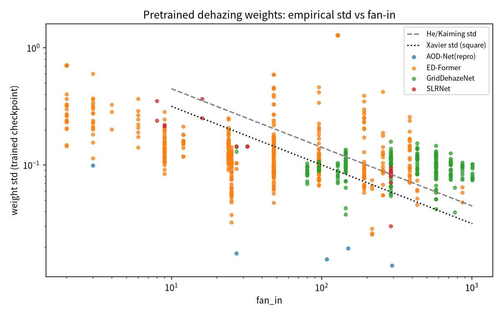
*Figure 1. Post-training weight standard deviation against fan-in, with He/Kaiming and Xavier reference curves.*

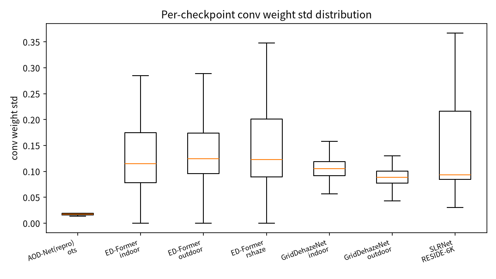
*Figure 2. Distribution of conv weight standard deviation per checkpoint.*

## 3 Initialization theory

### 3.1 Forward and backward variance propagation

For a linear layer `y_j = Σ_i w_ji x_i`, assuming zero-mean independent inputs:
`Var(y_j) = fan_in · Var(w) · E[x²]`. Forward variance preservation requires
`fan_in·Var(w)·E[x²] ≈ E[y²]`; back-propagation gives
`fan_out·Var(w)·Var(∂L/∂y) ≈ Var(∂L/∂x)`. Too-small weights make signal and gradient
decay geometrically across layers; too-large weights amplify both. Initializing all
weights to the same value also breaks neuron symmetry and prevents differentiated
features from being learned.

### 3.2 Classical variance-preserving rules

Xavier/Glorot (for near-symmetric activations such as tanh) uses
`Var(w) = 2/(fan_in+fan_out)`, a compromise between the forward and backward
conditions. He/Kaiming (for ReLU) accounts for the activation retaining about half the
second moment and uses `Var(w) = 2/fan_in`. In a residual stack `x ← x + F(x)`,
branch variance accumulates block by block; DehazeFormer introduces the depth gain
`gain(D) = (8D)^(-1/4)` to constrain branch scale, while query/key projections skip
this gain and use Xavier truncated normal directly.

### 3.3 Constraints from the dehazing physical model

The atmospheric scattering model is `I(x) = J(x)t(x) + A(1−t(x))`, with inversion
`J = (I − A(1−t))/max(t, ε)`. Dehazing is a low-magnitude restoration task: the clean
image can be written as the hazy image plus a residual `J = I + R(I)`, so a sensible
initialization should give `R ≈ 0`, i.e. the network starts at an identity mapping. For
branches that explicitly estimate `t` and `A`, the sigmoid bias should land on a
reasonable physical prior: transmission prior `t0`, atmospheric-light prior `a0`,
biases `logit(t0)` and `logit(a0)` respectively. Attention gates through sigmoid
should start at 0.5 (bias 0); normalization weight 1, bias 0; the output must stay in
`[0, 1]`, and the reconstruction-head bias must not introduce a systematic brightness
shift.

## 4 Computation-graph modeling and topology analysis

### 4.1 Networks as directed acyclic graphs

Most initialization rules only look at layer type (conv/linear/norm/attention) and
global depth; they do not exploit how layers are connected. We abstract each dehazing
network as a DAG `G = (V, E)`: every operation recorded by autograd in one dummy forward
pass is a node `v ∈ V`; tensor data-flow links are edges `e ∈ E`. Node classes are
conv/linear, attention gate (sigmoid), residual add, dense concat, activation, pooling
and normalization. Edge classes are main path, residual skip, dense-concat branch and
gating modulation. The extraction relies only on the PyTorch autograd graph and does not
hard-code architecture names, so it applies to any `nn.Module`.

### 4.2 Graph descriptors

For every learnable node (conv/linear) we extract:

- `d_v`: longest-path depth from an input source (critical-path depth), normalized to
  `ρ_v = d_v / D_crit ∈ [0, 1]`;
- `k_v`: in-degree, i.e. number of incoming tensor branches; if the direct predecessor
  is a concat node, we inherit the concat's in-degree as the dense-branch count;
- out-degree: number of downstream consumers;
- op class and module name.

At model level we aggregate node count, edge count, critical-path depth, graph density,
residual-add count, gate count and concat count.

### 4.3 Measured topology of the seven backbones

**Table 3. Computation-graph topology metrics (autograd tracing)**

| Model | Nodes | Edges | Critical depth | Residual adds | Gates | Concats | Density | Params |
|---|---:|---:|---:|---:|---:|---:|---:|---:|
| AOD-Net | 17 | 22 | 16 | 1 | 0 | 3 | 0.081 | 1,761 |
| DehazeNet | 19 | 20 | 15 | 0 | 2 | 0 | 0.058 | 1,716 |
| GFN | 24 | 25 | 8 | 3 | 0 | 1 | 0.045 | 447 |
| FFA-Net | 35 | 42 | 34 | 5 | 4 | 0 | 0.035 | 10,401 |
| GridDehazeNet | 33 | 42 | 32 | 3 | 2 | 4 | 0.040 | 7,487 |
| MSBDN | 10 | 11 | 9 | 1 | 0 | 1 | 0.122 | 1,811 |
| DehazeFormer | 35 | 42 | 34 | 9 | 0 | 0 | 0.035 | 9,011 |

The measurements show a clear split. FFA-Net and DehazeFormer have 35 nodes and a
critical depth of 34, with 5 and 9 residual adds respectively — typical deep residual
stacks. GridDehazeNet contains four dense-concat nodes, the signature of residual dense
blocks. AOD-Net has three concat nodes and GFN three residual adds (three-branch
confidence fusion): shallow multi-branch graphs. MSBDN is the sparsest graph (10 nodes,
11 edges). Graph density drops with depth: deep residual graphs connect sparsely, with
signal flowing mainly along the critical path and skips; shallow multi-branch graphs are
denser, with more prominent branch fusion.

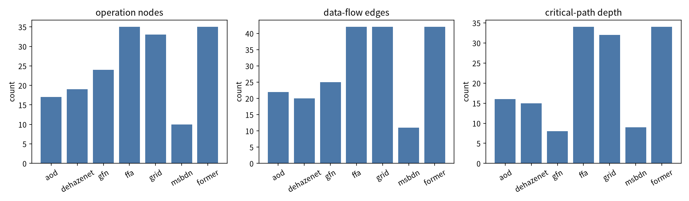
*Figure 3. Graph size and critical-path depth comparison across the seven models.*

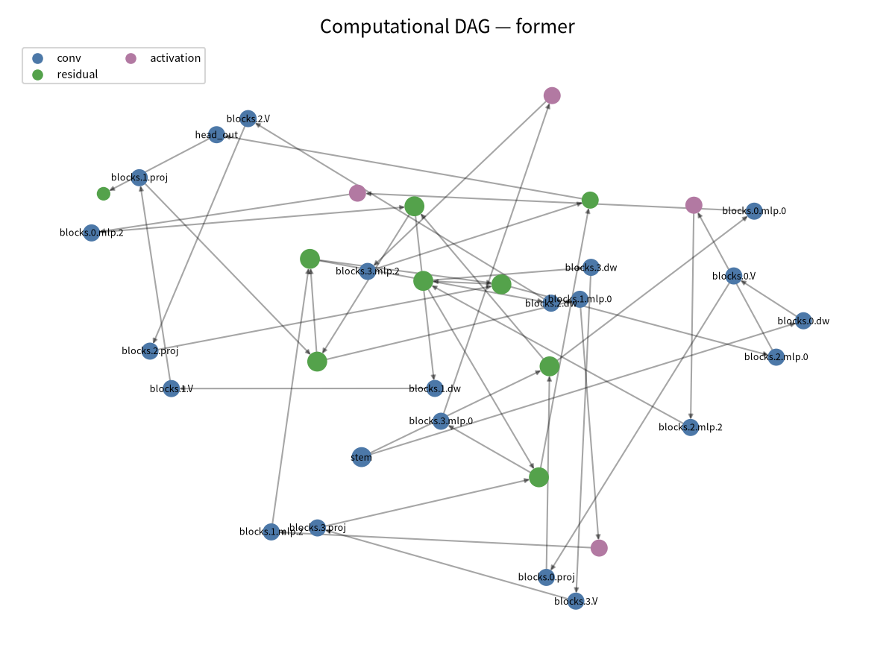
*Figure 4. DehazeFormer computation DAG (blue: conv; green: residual add; purple:
activation).*

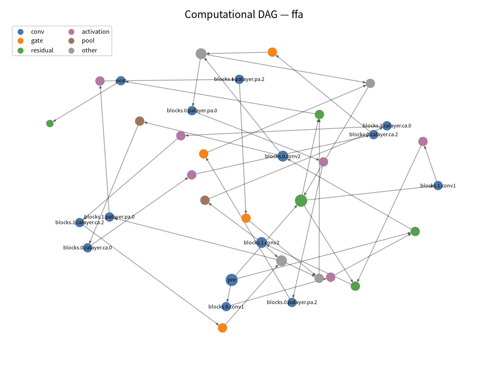
*Figure 5. FFA-Net computation DAG; red edges are pixel/channel attention gate
branches.*

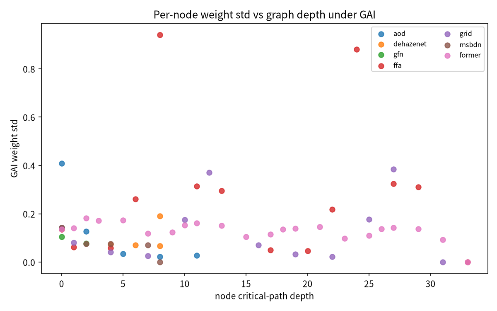
*Figure 6. Per-node GAI weight standard deviation against graph depth.*

## 5 DPI: dehazing-aware parameter initialization

### 5.1 Overall procedure

DPI runs in four stages: (1) symmetry breaking — all weights sampled from truncated
normal, avoiding all-zero or all-equal values; (2) body variance preservation — ReLU
body blocks/MLP/V/proj use `std = gain(D)·√(2/fan_in)`, `gain(D) = (8D)^(-1/4)`, bias
zero; (3) role-specific rules; (4) optional forward variance calibration.

**Table 4. DPI per-role initialization rules**

| Network role | Weight scale | Bias |
|---|---|---|
| Q/K projection | `std = √(2/(fan_in+fan_out))`, Xavier truncated normal | 0 |
| Attention gate last conv | small He scale | 0 (gate starts at 0.5) |
| Residual / reconstruction head (identity) | weight and bias all zero, with global skip | 0 |
| Residual / reconstruction head (eps) | `0.1·gain(D)·√(2/fan_in)` small scale | 0 |
| Transmission head | body variance-preserving rule | `logit(t0)` |
| Atmospheric-light head | body variance-preserving rule | `logit(a0)` |
| Normalization | weight 1 | 0 |

### 5.2 Two residual-head modes and the trade-off

DPI-Identity sets the reconstruction head weights to zero; together with the global
skip connection the initial output equals the input and the identity residual is zero.
The price is that gradients back to the body are approximately zero at the first step;
only the head receives gradient. DPI-Eps sets the head to a 0.1× small scale, trading a
tiny identity departure for first-step gradient flow into the body. In practice the two
modes can be chosen by network depth and training stage.

### 5.3 Forward variance calibration (optional)

After random initialization, a small batch of hazy images is passed forward once; the
output standard deviation of each layer is measured, and the corresponding layer weights
(biases untouched) are scaled toward the target second moment. This is a lightweight
data-dependent initialization implemented by `calibrate_forward`.

## 6 GAI: graph-aware initialization (proposed)

### 6.1 Motivation: from a global depth gain to a per-node budget

DPI follows DehazeFormer in applying one global depth gain to all body blocks. The
computation graph shows, however, that nodes in the same network differ widely in path
position and branch structure: stem nodes are far from the output, deep nodes sit at
the residual-accumulation end; dense-concat nodes merge `k` independent branches whose
output second moments add. One global gain is structurally coarse for these nodes. GAI
keeps the DPI role rules but bases the variance budget on the graph descriptors from
Section 4.

### 6.2 Per-node variance budget derivation

For node `v`, take the He bandwidth as base `σ0 = √(2/fan_in)`. Along a residual path
the block output variance satisfies `Var(x_{l+1}) = Var(x_l) + Var(F_l)`, so branch
variance should shrink gradually with path depth. We define the depth gain by the
normalized critical-path position `ρ_v`:

`g_v = [ 8·(1 + ρ_v(D − 1)) ]^(−1/4)`

Shallow nodes (`ρ_v ≈ 0`) keep the larger budget `8^(−1/4)`; end-of-path nodes
(`ρ_v ≈ 1`) degenerate to `(8D)^(−1/4)`, matching the global depth gain. For a node
merging `k` independent branches, branch second moments add, so the branch coefficient
is `b_v = 1/√k_v`. Body weight standard deviation:

`σ_v = g_v · b_v · √(2/fan_in)`

Q/K projections, attention gates, reconstruction heads and physics heads keep the DPI
role rules: QK Xavier truncated normal; gate small He; reconstruction head zero
(GAI-Identity) or 0.1× small scale (GAI-Eps); transmission/atmospheric-light biases
`logit(t0)`, `logit(a0)`; normalization weight 1, bias 0.

**Table 5. GAI per-node variance budget rules**

| Node role | Weight scale | Bias |
|---|---|---|
| Body / MLP / V / proj | `σ = g_v·b_v·√(2/fan_in)`, truncated normal | 0 |
| Q/K projection | `σ = √(2/(fan_in+fan_out))`, Xavier truncated normal | 0 |
| Attention gate last conv | small He, no depth gain | 0 |
| Dense-concat aggregation node | body scale further multiplied by `1/√k_v` | 0 |
| Reconstruction head (identity) | weight and bias all zero | 0 |
| Reconstruction head (eps) | `0.1·g_v·b_v·√(2/fan_in)` small scale | 0 |
| Transmission / atmospheric-light head | body variance-preserving rule | `logit(t0) / logit(a0)` |

### 6.3 Relation to DPI

GAI is the graph-structural generalization of DPI. When path depth is similar across
nodes and there are no multi-branch concats, the differences in `ρ_v` and `k_v` vanish,
`g_v` degenerates to the global depth gain, and GAI is equivalent to DPI. The role
priors (identity start, physics-head bias, gate initialization) are identical; the only
difference is whether the body bandwidth is adjusted per graph position. Implementation
traces one dummy forward pass before initialization, reads the descriptors, then
samples parameters; tracing costs one CPU forward pass and adds no training-time
computation.

## 7 Experimental setup

### 7.1 Reproduced models and data

Seven lightweight models are reproduced, corresponding to AOD-Net (five-conv
cross-layer concat), DehazeNet (Maxout + BReLU, explicit t/A heads and model
inversion), GFN (white-balance/contrast/gamma branches + softmax confidence fusion),
FFA-Net (channel/pixel attention residual blocks), GridDehazeNet (residual dense blocks
+ channel attention), MSBDN (multi-level dense fusion) and DehazeFormer (depthwise conv
+ 1×1 projection + MLP residual stack). Training pairs are synthesized by the
atmospheric scattering model: clean images are generated from smooth fields plus
texture; atmospheric light `A ∈ [0.7, 1.0]`, transmission `t ∈ [0.3, 1.0]`, and
`I = Jt + A(1−t)`. No external dataset is used.

### 7.2 Schemes and protocol

Nine schemes are compared: PyTorch default, Xavier, He/Kaiming, DCGAN(0.02),
depth-scaled truncated normal, DPI-Identity, DPI-Eps, GAI-Identity, GAI-Eps. In the
initial probe stage, input is 64×64, batch 4; each model × scheme repeats over three
random seeds. Metrics: initial identity residual `‖out−I‖/‖I‖`, initial PSNR against
the clean image, gradient norm, zero-gradient parameter fraction, per-layer activation
standard deviation and body gradient standard deviation.

In the short-training stage, a fixed pool of 48 training pairs and 32 validation pairs
(32×32, synthesis seeds 100/200, fixed) is used; Adam, learning rate 1e-3, MSE loss,
12 epochs, batch 8, two random seeds. We record initial/final/best validation PSNR,
training loss curves and final gradient health. Graph topology analysis traces the
same seven backbones and outputs node/edge/depth/branch statistics and per-node
descriptors.

## 8 Results

### 8.1 Initial identity behavior and output quality

**Table 6. Initial-state metrics for nine schemes on seven models (three-seed mean)**

| Model | Scheme | Identity residual ↓ | Init PSNR ↑ | Grad norm | Zero-grad fraction ↓ |
|---|---|---:|---:|---:|---:|
| AOD-Net | default | 0.626 | 5.71 | 0.263 | 0.343 |
| AOD-Net | xavier | 0.593 | 6.01 | 0.349 | 0.155 |
| AOD-Net | kaiming | 0.557 | 6.46 | 0.464 | 0.172 |
| AOD-Net | dcgan | 0.635 | 5.55 | 0.168 | 0.279 |
| AOD-Net | depth_trunc | 0.629 | 5.61 | 0.204 | 0.348 |
| AOD-Net | DPI | 0.626 | 5.65 | 0.213 | 0.330 |
| AOD-Net | DPI-Eps | 0.626 | 5.65 | 0.213 | 0.330 |
| AOD-Net | GAI | 0.630 | 5.60 | 0.241 | 0.043 |
| AOD-Net | GAI-Eps | 0.630 | 5.60 | 0.241 | 0.043 |
| DehazeNet | default | 0.258 | 11.39 | 0.098 | 0.225 |
| DehazeNet | xavier | 0.330 | 9.90 | 0.549 | 0.105 |
| DehazeNet | kaiming | 0.458 | 7.90 | 0.775 | 0.102 |
| DehazeNet | dcgan | 0.235 | 11.83 | 0.075 | 0.193 |
| DehazeNet | depth_trunc | 0.235 | 11.82 | 0.085 | 0.139 |
| DehazeNet | DPI | 0.237 | 11.78 | 0.114 | 0.119 |
| DehazeNet | DPI-Eps | 0.237 | 11.78 | 0.114 | 0.119 |
| DehazeNet | GAI | 0.236 | 11.81 | 0.099 | 0.190 |
| DehazeNet | GAI-Eps | 0.236 | 11.81 | 0.099 | 0.190 |
| GFN | default | 0.971 | 5.89 | 0.407 | 0.095 |
| GFN | xavier | 0.868 | 7.01 | 0.768 | 0.002 |
| GFN | kaiming | 0.776 | 7.76 | 0.433 | 0.001 |
| GFN | dcgan | 0.997 | 5.63 | 0.403 | 0.002 |
| GFN | depth_trunc | 0.975 | 5.85 | 0.442 | 0.002 |
| GFN | DPI | 0.946 | 6.15 | 0.513 | 0.002 |
| GFN | DPI-Eps | 0.946 | 6.15 | 0.513 | 0.002 |
| GFN | GAI | 0.773 | 8.30 | 0.519 | 0.006 |
| GFN | GAI-Eps | 0.773 | 8.30 | 0.519 | 0.006 |
| FFA-Net | default | 0.407 | 13.65 | 1.371 | 0.057 |
| FFA-Net | xavier | 0.645 | 7.63 | 3.668 | 0.033 |
| FFA-Net | kaiming | 1.989 | -1.40 | 36.394 | 0.028 |
| FFA-Net | dcgan | 0.021 | 16.60 | 0.208 | 0.074 |
| FFA-Net | depth_trunc | 0.082 | 17.76 | 0.269 | 0.060 |
| FFA-Net | DPI | 0.000 | 16.73 | 0.499 | 0.958 |
| FFA-Net | DPI-Eps | 0.022 | 17.11 | 0.467 | 0.075 |
| FFA-Net | GAI | 0.000 | 16.73 | 0.876 | 0.958 |
| FFA-Net | GAI-Eps | 0.034 | 16.39 | 0.932 | 0.090 |
| GridDehazeNet | default | 0.190 | 14.23 | 0.574 | 0.138 |
| GridDehazeNet | xavier | 0.793 | 6.95 | 4.127 | 0.089 |
| GridDehazeNet | kaiming | 1.990 | -1.29 | 22.380 | 0.105 |
| GridDehazeNet | dcgan | 0.012 | 16.90 | 0.167 | 0.240 |
| GridDehazeNet | depth_trunc | 0.096 | 16.15 | 0.354 | 0.106 |
| GridDehazeNet | DPI | 0.000 | 16.73 | 0.318 | 0.971 |
| GridDehazeNet | DPI-Eps | 0.022 | 16.71 | 0.321 | 0.150 |
| GridDehazeNet | GAI | 0.000 | 16.73 | 0.665 | 0.971 |
| GridDehazeNet | GAI-Eps | 0.039 | 16.93 | 0.647 | 0.249 |
| MSBDN | default | 0.210 | 14.21 | 0.432 | 0.246 |
| MSBDN | xavier | 0.437 | 10.68 | 1.551 | 0.148 |
| MSBDN | kaiming | 1.332 | 2.73 | 8.771 | 0.143 |
| MSBDN | dcgan | 0.001 | 16.73 | 0.141 | 0.337 |
| MSBDN | depth_trunc | 0.019 | 16.86 | 0.163 | 0.125 |
| MSBDN | DPI | 0.000 | 16.73 | 0.155 | 0.879 |
| MSBDN | DPI-Eps | 0.005 | 16.77 | 0.154 | 0.166 |
| MSBDN | GAI | 0.000 | 16.73 | 0.154 | 0.879 |
| MSBDN | GAI-Eps | 0.005 | 16.83 | 0.152 | 0.279 |
| DehazeFormer | default | 0.297 | 13.85 | 1.365 | 0.108 |
| DehazeFormer | xavier | 2.284 | -2.66 | 51.474 | 0.016 |
| DehazeFormer | kaiming | 951.910 | -55.28 | 9,658,759.750 | 0.010 |
| DehazeFormer | dcgan | 0.021 | 16.64 | 0.229 | 0.069 |
| DehazeFormer | depth_trunc | 0.071 | 16.68 | 0.403 | 0.042 |
| DehazeFormer | DPI | 0.000 | 16.73 | 0.519 | 0.952 |
| DehazeFormer | DPI-Eps | 0.024 | 16.71 | 0.529 | 0.051 |
| DehazeFormer | GAI | 0.000 | 16.73 | 0.965 | 0.952 |
| DehazeFormer | GAI-Eps | 0.031 | 16.39 | 1.021 | 0.050 |

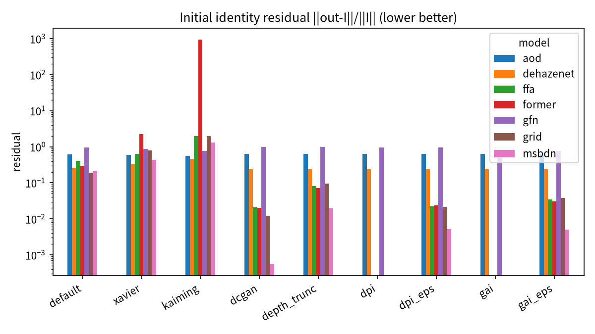
*Figure 7. Initial identity residual (log axis; lower is closer to identity).*

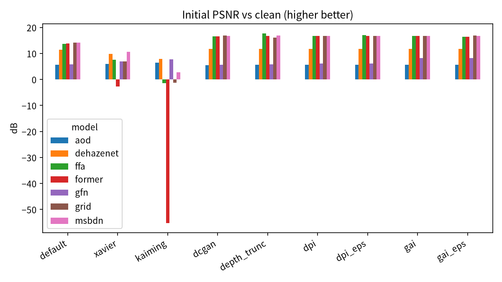
*Figure 8. Initial output PSNR against the clean image (higher is better).*

On the four networks with a global residual (FFA-Net, DehazeFormer, GridDehazeNet,
MSBDN), DPI-Identity and GAI-Identity start with residual 0.000 and initial PSNR about
16.73 dB, i.e. the initial output is the input itself. Their eps variants start at
residual 0.005–0.039, PSNR 16.4–16.9 dB, still near identity. He/Kaiming without depth
scaling reaches a residual of about 952 on DehazeFormer with negative initial PSNR;
Xavier also amplifies on the deep stack. DCGAN(0.02) keeps a low residual thanks to its
small weight scale. AOD-Net, DehazeNet and GFN are formula-reconstruction or
branch-fusion structures rather than global residuals, so the residual criterion does
not apply to them.

### 8.2 Gradient health

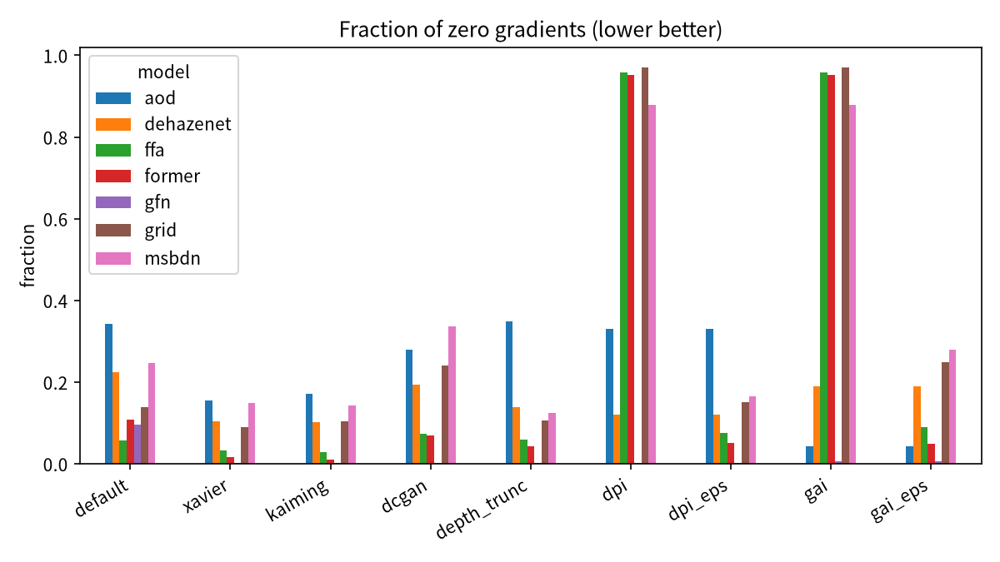
*Figure 9. Zero-gradient parameter fraction (lower means healthier first-step gradient
flow).*

The identity variant leaves body gradients approximately zero at the first step because
the head weights are zero; its zero-gradient fraction is about 0.88–0.97. The eps
variant lowers this to about 0.05–0.28, in the same healthy range as depth-scaled and
DCGAN schemes. He/Kaiming has a low zero-gradient fraction but a gradient norm of
10^4–10^6, i.e. explosion rather than healthy flow. GAI-Eps stays in the same range as
DPI-Eps; the per-node depth discount does not sacrifice gradient flow.

### 8.3 Layer-wise activation variance profile

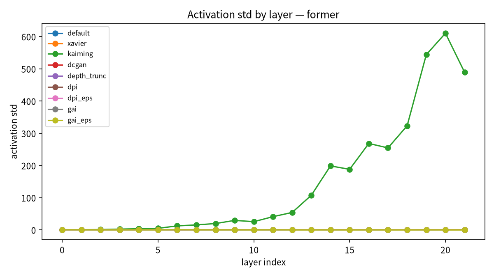
*Figure 10. Per-layer activation standard deviation on DehazeFormer.*

The activation profile shows that depth-scaled, DPI and GAI schemes keep a more stable
inter-layer activation variance; He/Kaiming and Xavier activation variance rises
quickly with depth, consistent with residual-stack variance accumulation. Figure 6
further shows that GAI weight std shrinks toward path end, while attention gate branches
keep an independent small-scale bandwidth, matching the budget design of Section 6.

### 8.4 Physics-prior bias ablation

**Table 7. Transmission prior `t0` and atmospheric-light prior `a0` ablation: initial
reconstruction PSNR (dB)**

| `t0` \ `a0` | 0.80 | 0.90 | 0.97 |
|---|---:|---:|---:|
| 0.50 | 17.77 | 14.53 | 12.40 |
| 0.70 | 20.53 | **21.65** | 21.12 |
| 0.90 | 17.66 | 18.28 | 18.71 |
| 0.97 | 16.81 | 16.97 | 17.08 |

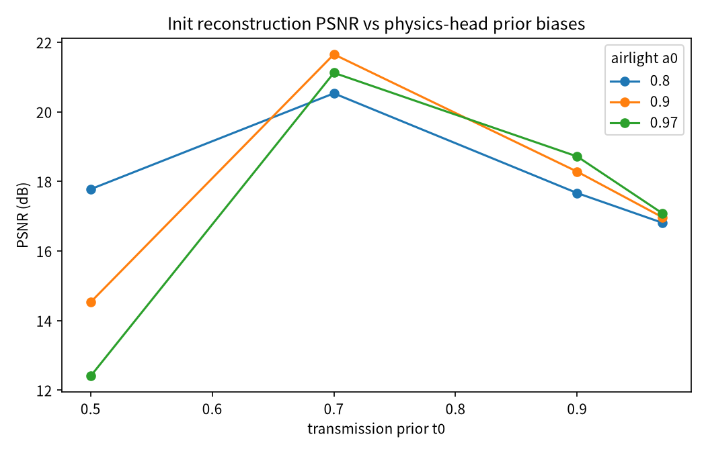
*Figure 11. Initial reconstruction PSNR against physics-head prior biases.*

On the synthetic haze concentration, `t0 ≈ 0.70`, `a0 ≈ 0.90` gives the highest
initial reconstruction PSNR (21.65 dB); `t0 = 0.50` is too dark and `t0 = 0.97` too
close to clean; deviating from `a0 = 0.90` lowers PSNR. Physics-head biases should match
the haze-concentration and atmospheric-light statistics of the dataset, rather than
taking extreme values; in deployment `t0`, `a0` can be estimated from dark-/bright-channel
statistics of a hazy batch.

### 8.5 Short-training convergence comparison

**Table 8. Final validation PSNR after short training (dB, two-seed mean)**

| Model | Default | Xavier | Kaiming | DCGAN | Depth-trunc | DPI | DPI-Eps | GAI | GAI-Eps |
|---|---:|---:|---:|---:|---:|---:|---:|---:|---:|
| AOD-Net | 16.60 | 17.19 | 16.90 | 17.23 | 17.32 | 17.38 | 17.38 | 16.66 | 16.66 |
| DehazeNet | 16.34 | **17.91** | 17.81 | 16.06 | 16.52 | 16.60 | 16.60 | 17.42 | 17.42 |
| FFA-Net | 21.62 | 20.57 | 14.73 | 21.35 | 21.69 | 21.76 | 21.75 | 21.79 | **21.80** |
| DehazeFormer | 21.72 | 18.95 | 5.62 | 21.36 | 21.67 | 21.87 | 21.86 | 21.89 | **21.91** |
| GFN | 12.60 | 14.55 | 13.13 | 15.08 | 15.66 | **16.05** | 16.05 | 15.81 | 15.81 |
| GridDehazeNet | 21.58 | 19.93 | 15.18 | 21.23 | 21.59 | 21.51 | 21.62 | 21.57 | **21.68** |
| MSBDN | **21.25** | 21.06 | 18.52 | 21.15 | 21.22 | 21.23 | 21.23 | 21.19 | 21.19 |

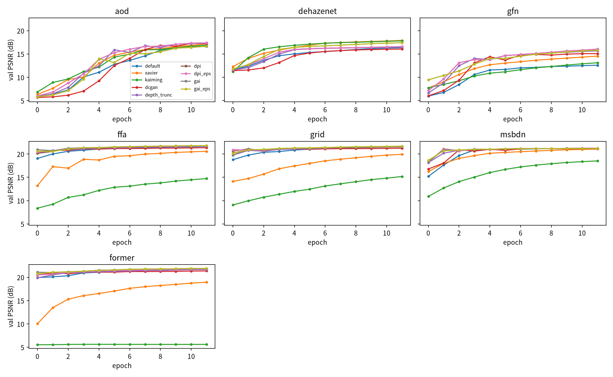
*Figure 12. Training-loss convergence curves per model × scheme (two seeds).*

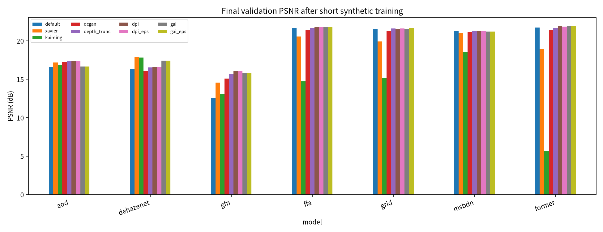
*Figure 13. Final validation PSNR after short training.*

The short-training results show clear architecture- and topology-dependent behavior. On
deep residual stacks, GAI, DPI, depth-scaled truncated normal and DCGAN converge stably
and rank at the top: GAI-Eps reaches 21.80 dB on FFA-Net, 21.91 dB on DehazeFormer and
21.68 dB on GridDehazeNet, the best in their groups; GAI-Identity gives 21.79, 21.89 and
21.57 dB, statistically tied with DPI (21.76, 21.87, 21.51 dB). He/Kaiming drops to
14.73, 5.62, 15.18 and 18.52 dB on these four networks; on DehazeFormer its training
loss reaches 2217.65 with validation PSNR only 5.62 — direct divergence. Xavier also
lags to varying degrees on the deep stack.

On shallow and multi-branch networks the conclusion reverses: on DehazeNet Xavier
(17.91 dB) and He/Kaiming (17.81 dB) are slightly better; GAI (17.42 dB) beats DPI
(16.60 dB). On AOD-Net DPI (17.38 dB) is best, GAI (16.66 dB) slightly lower. On GFN DPI
(16.05 dB) is best, GAI (15.81 dB) next, PyTorch default (12.60 dB) worst. On MSBDN all
schemes are close, default (21.25 dB) and DPI (21.23 dB) slightly above GAI (21.19 dB).
This indicates that the payoff of graph-aware variance budgeting comes mainly from deep
residual graphs and multi-branch dense structures; shallow formula-reconstruction nets do
not necessarily benefit from path-depth scaling, and the initialization choice should
match graph topology.

## 9 Discussion and limitations

### 9.1 Main findings

First, initialization practice in public dehazing code is inconsistent: many
convolutional networks use the framework default without restoration-aware prior design.
Second, deep residual stacks are sensitive to weight scale; He/Xavier without depth
scaling tend to amplify forward and backward signals and can diverge outright. Third, the
near-identity prior of restoration networks should be realized explicitly through the
global skip and reconstruction-head scale; zero-init identity start is the most stable,
small-scale start improves first-step gradient flow, and the trade-off should follow
network depth. Fourth, explicit physics-head bias is an exploitable prior channel whose
value should match dataset statistics. Fifth, once the network is modeled as a computation
graph, critical-path depth and dense-branch count are automatically extractable
topological descriptors; the per-node budget GAI matches or slightly beats the global-gain
DPI on deep residual graphs, with no clear gain on shallow nets — initialization payoff is
architecture- and topology-dependent.

### 9.2 Limitations and future validation

This study has the following boundaries. Experiments run on CPU lightweight models and
32×32 synthetic pairs; the 12-epoch short training with a small sample captures early
convergence trends rather than final accuracy. The autograd graph is at operation
granularity; critical-path depth and block depth carry a fixed conversion ratio, and we
use normalized path position to avoid unit mismatch; finer block-level and
attention-head-level topology modeling remains to be extended. Official FFA-Net and
DehazeFormer weights are hosted on Google Drive and Baidu Pan and were unreachable in
this environment, so they are not included in the real-weight statistics. Synthetic data
and real haze distributions differ. Future work should run on GPU (e.g. an AutoDL 5090),
compare convergence speed, final PSNR/SSIM and multi-seed variance on RESIDE-ITS/OTS and
other standard datasets, verify descriptor stability on larger encoder-decoder and
window-attention models, and test the practical gains of forward variance calibration and
physics-prior bias estimation.

## 10 Conclusion

This study surveys initialization practice in nine representative dehazing models,
proposes the DPI initialization from variance propagation and the atmospheric scattering
model, and further abstracts the network as a computation graph to extract critical-path
depth and dense-branch descriptors, yielding the per-node variance-budget GAI algorithm.
Seven-model initial probes and short-training comparison verify the identity-start vs
gradient-health trade-off, the dependence of initialization on depth and graph topology,
and quantify the effect of physics-prior biases. GAI ties or wins on deep residual stacks
and stays competitive on shallow nets. The implementation, graph tracer, weight
statistics scripts and experimental results are delivered with this report and can be
plugged into a standard GPU training pipeline for convergence validation.

## References

1. Cai B, Xu X, Jia K, et al. DehazeNet: An End-to-End System for Single Image Haze
   Removal[J]. IEEE Transactions on Image Processing, 2016, 25(11): 5187-5198.
   arXiv:1601.07661.
2. Li B, Peng X, Wang Z, et al. AOD-Net: All-in-One Dehazing Network[C]//Proc. ICCV.
   2017: 4770-4778.
3. Qin X, Wang Z, Bai Y, et al. FFA-Net: Feature Fusion Attention Network for Single
   Image Dehazing[J]. AAAI, 2020, 34(07): 11908-11915. DOI:10.1609/aaai.v34i07.6865.
4. Liu X, Ma Y, Shi Z, et al. GridDehazeNet: Attention-Based Multi-Scale Network for
   Image Dehazing[C]//Proc. ICCV. 2019.
5. Song Y, et al. Vision Transformers for Single Image Dehazing[J]. IEEE TIP, 2023.
6. Glorot X, Bengio Y. Understanding the Difficulty of Training Deep Feedforward Neural
   Networks[C]//Proc. AISTATS. 2010: 249-256.
7. He K, Zhang X, Ren S, et al. Delving Deep into Rectifiers[C]//Proc. ICCV. 2015:
   1026-1034.
8. On Weight Initialization in Deep Neural Networks[J]. arXiv:1704.08863, 2017.
9. A Comprehensive Survey on Image Dehazing Based on Deep Learning[J].
   arXiv:2106.03323, 2021.
10. Weight Initialization and Variance Dynamics in Deep Neural Networks and Large
    Language Models[J]. arXiv:2510.09423, 2025.
11. Hagberg A, Schult D, Swart P. Exploring Network Structure, Dynamics, and Function
    using NetworkX[C]//Proc. SciPy. 2008: 11-15.
12. SLRNet: Super-Lightweight Residual Network for Single Image Dehazing[EB/OL].
    https://github.com/Unk1ndledAC/SLRNet.

## Appendix A Code and reproduction

`src/dehaze_init` contains initialization schemes, reproduced models, synthetic data
generation, weight statistics, the probe and the computation-graph module;
`src/experiments` contains the executable scripts; `analysis` stores CSV results and
figures. Run in order:

```bash
python src/experiments/run_checkpoint_analysis.py
python src/experiments/run_graph_analysis.py
python src/experiments/run_init_comparison.py
python src/experiments/run_training_experiment.py
python src/experiments/run_prior_ablation.py
python src/experiments/run_weight_plots.py
```
